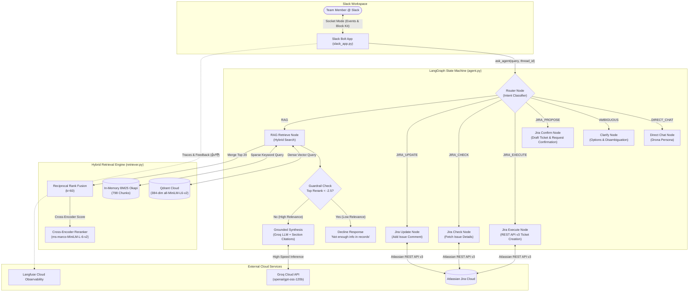

# 🏹 Drona (द्रोण) — Enterprise Agentic Slack Assistant & Hybrid RAG System

[](https://www.python.org/)
[](https://github.com/langchain-ai/langgraph)
[](https://qdrant.tech/)
[](https://groq.com/)
[](https://developer.atlassian.com/cloud/jira/platform/rest/v3/)
[](https://slack.dev/bolt-python/)
[-brightgreen.svg)](evals/)

**Drona** is a production-grade, agentic enterprise workplace assistant built for **NexaTech Solutions** (a mid-sized IT consulting and cloud services firm). Operating seamlessly inside Slack via Socket Mode, Drona orchestrates internal policy discovery, technical runbook lookups, multi-step Jira issue management with human-in-the-loop approvals, and anti-hallucination guardrails.

---

## 🏛️ System Architecture



---

## 🌟 Core Capabilities

### 1. Hybrid Search & Cross-Encoder Reranking
- **Dense Vector Search**: Powered by `sentence-transformers/all-MiniLM-L6-v2` (384-dimensional cosine embeddings) hosted in a cloud Qdrant cluster.
- **Sparse BM25 Keyword Search**: In-memory Okapi BM25 index over 798 chunks for precision on exact error codes, policy numbers, and acronyms.
- **Reciprocal Rank Fusion (RRF)**: Merges dense and sparse rankings using standard $k=60$ reciprocal rank weighting.
- **Cross-Encoder Reranker**: Employs `cross-encoder/ms-marco-MiniLM-L-6-v2` to score joint `(query, chunk)` pairs, sorting top 20 fused candidates down to top 5.

### 2. Multi-Intent LangGraph State Machine
- **Knowledge Questions**: Routed to the hybrid RAG pipeline.
- **Action Requests (Jira)**: Interactive ticket creation, status checks, and comments.
- **Human-in-the-Loop Confirmation**: Drona **never creates a ticket unilaterally**. It drafts the parameters and explicitly prompts the user to reply `confirm` or `cancel` within the Slack thread before calling the Atlassian REST API.
- **Ambiguity Clarifier**: Detects vague inputs (e.g. `"leave"`, `"vpn"`) and prompts for clarification with concrete options rather than returning irrelevant documents.

### 3. Anti-Hallucination Guardrails & Authoritative Citations
- **Mathematical Score Threshold**: If the top document's rerank score is below `-2.5`, Drona immediately declines: *"I don't have enough information on that in our company records"*, saving token costs and eliminating hallucinations.
- **Section-Level Citations**: Answers cite exact document names AND section headers (e.g. `parental_maternity_paternity_leave.md (Section: 2. Maternity Leave (Biological Mothers))`).

---

## 📊 Evaluation & Benchmark Results

The system is rigorously benchmarked using a **40-question Golden Evaluation Dataset** (`evals/golden_dataset.json`) spanning 16 enterprise documents across 7 operational categories, evaluated by `pytest` and an LLM-as-a-judge (`openai/gpt-oss-120b`).

```
============================================================================================
CATEGORY                     COUNT   HIT RATE @ 5     MRR @ 5      CORRECTNESS   
--------------------------------------------------------------------------------------------
hr_benefits                  8       100.0%           0.9375       93.8%         
travel_and_expense           6       100.0%           1.0000       75.0%         
engineering_and_devops       6       100.0%           0.9167       91.7%         
it_and_workplace             6       100.0%           1.0000       100.0%        
compensation_and_payroll     5       100.0%           1.0000       100.0%        
multi_doc                    5       100.0%           0.8667       90.0%         
unanswerable                 4       N/A              N/A          100.0% (Zero Hallucination)
--------------------------------------------------------------------------------------------
OVERALL SUMMARY              40      100.0%           0.9537       92.5%
============================================================================================
```

### Pytest Verification Output
```bash
$ pytest evals/test_eval.py -v -s

evals/test_eval.py::test_golden_dataset_integrity PASSED
evals/test_eval.py::test_retrieval_hit_rate 
[EVAL METRIC] Overall Retrieval Hit Rate @ 5: 100.0%
PASSED
evals/test_eval.py::test_retrieval_mrr 
[EVAL METRIC] Overall Retrieval MRR @ 5: 0.9537
PASSED
evals/test_eval.py::test_answer_correctness 
[EVAL METRIC] Overall Answer Correctness: 92.5%
PASSED
evals/test_eval.py::test_unanswerable_guardrail 
[GUARDRAIL] Unanswerable Questions Declined Correctly: 100.0% (4/4)
PASSED
evals/test_eval.py::test_category_coverage PASSED

============================= 6 passed in 32.32s ==============================
```

---

## 💬 Real Conversation Demonstrations

### Scenario 1: Factual Policy Retrieval with Section Citations
```text
User: How many days of paid maternity leave are female employees entitled to?

Drona: Female employees expecting up to two surviving children are entitled to 
182 calendar days (26 continuous weeks) of fully paid maternity leave, provided 
they worked at NexaTech for at least 80 working days in the preceding 12 months.

📚 Sources Cited:
- parental_maternity_paternity_leave.md (Section: 2. Maternity Leave (Biological Mothers))
- employee_handbook.md (Section: 4. Statutory Benefits & Leave Entitlements)
```

### Scenario 2: Jira Ticket Creation with Human-in-the-Loop Confirmation
```text
User: Create a Jira ticket: Database connection pool exhausted on read replica 2

Drona: ⚠️ Confirmation Required Before Creating Ticket
I have prepared the following Jira ticket for NexaTech Solutions:
• Project: KAN
• Summary: Database connection pool exhausted on read replica 2
• Issue Type: Task
• Priority: High

👉 Please reply with 'confirm' (or 'yes') to create this ticket, or 'cancel' to abort.

User (in thread): confirm

Drona: ✅ Jira Ticket Created Successfully!
• Ticket Key: KAN-7
• Summary: Database connection pool exhausted on read replica 2
• Issue Type: Task | Priority: High | Status: To Do
• Link: https://thevirtualthinkers.atlassian.net/browse/KAN-7
```

### Scenario 3: Jira Ticket Status Check & Comment Updating
```text
User: Check status of ticket KAN-7

Drona: 📋 Jira Ticket Details: KAN-7
• Summary: Database connection pool exhausted on read replica 2
• Status: To Do
• Priority: High
• Issue Type: Task
• Assignee: Unassigned
• Link: https://thevirtualthinkers.atlassian.net/browse/KAN-7

User: Update ticket KAN-7 with comment: SRE on-call investigating connection leaks

Drona: 💬 Jira Ticket Updated: KAN-7
• Comment added: "SRE on-call investigating connection leaks"
• Link: https://thevirtualthinkers.atlassian.net/browse/KAN-7
```

### Scenario 4: Ambiguous Request Clarification
```text
User: leave

Drona: ❓ Could you please clarify your request?
Are you looking to (1) request a leave of absence, (2) check your current 
leave balance, or (3) view NexaTech's annual, sick, or maternity leave policies?

*(You can also ask about NexaTech travel allowances, laptop upgrades, or file a Jira ticket!)*
```

### Scenario 5: Anti-Hallucination Guardrail in Action
```text
User: What is the company reimbursement policy for pet insurance?

Drona: [Guardrail Check] Top score -5.9422 < threshold -2.5.
I don't have enough information on that in our company records.
```

---

## 🚀 Quickstart & Setup Guide

### Prerequisites
- Python 3.11+
- Git
- Docker & Docker Compose (Optional, for containerized run)

### 1. Clone & Configure Environment
```bash
git clone https://github.com/Starlitakash/Drona.git
cd Drona

# Copy template and fill in your keys
cp .env.example .env
```

Your `.env` file requires:
```dotenv
# 1. Groq Inference API
GROQ_API_KEY=gsk_...
GROQ_MODEL=openai/gpt-oss-120b

# 2. Slack Socket Mode Credentials
SLACK_BOT_TOKEN=xoxb-...
SLACK_APP_TOKEN=xapp-...

# 3. Qdrant Cloud Vector Database
QDRANT_URL=https://<your-cluster-id>.qdrant.io
QDRANT_API_KEY=...

# 4. Atlassian Jira Cloud REST API (Optional - operates in mock mode if unset)
JIRA_SERVER=https://your-domain.atlassian.net
JIRA_PROJECT=KAN
JIRA_EMAIL=your-email@nexatech.com
JIRA_API_TOKEN=ATATT3...

# 5. Langfuse Observability (Optional)
LANGFUSE_PUBLIC_KEY=pk-lf-...
LANGFUSE_SECRET_KEY=sk-lf-...
LANGFUSE_BASE_URL=https://us.cloud.langfuse.com
```

### 2. Local Setup
```bash
# Create and activate virtual environment
python -m venv venv
.\venv\Scripts\Activate.ps1    # On Windows
source venv/bin/activate       # On Linux/macOS

# Install dependencies
pip install -r requirements.txt
```

### 3. Usage Modes (`main.py`)

#### A. Interactive Terminal Chat (No Slack required!)
```bash
python main.py --cli
```

#### B. Start Slack Bot (Socket Mode)
```bash
python main.py --slack
```

#### C. Ingest Documents into Qdrant Cloud
```bash
python main.py --ingest
```

#### D. Run Evaluation Benchmark & Pytest Suite
```bash
python main.py --eval
python main.py --test
# Or directly:
pytest evals/test_eval.py -v -s
```

---

## 🐳 Docker Deployment

Drona is 100% cloud-native with zero local database dependencies. It connects directly to Qdrant Cloud and Groq API.

```bash
# Build and run container in detached mode
docker compose up --build -d

# Check live logs
docker compose logs -f
```

---

## 🔮 What I'd Improve Next

1. **Semantic Response Caching (Redis / Upstash)**:
   - Cache exact query embeddings to serve repeated employee questions (e.g., *"What are public holidays this year?"*) in $<50\text{ms}$ with zero LLM API cost.
2. **Asynchronous Distributed Task Queues (Celery / Redis)**:
   - Offload hybrid search and LLM calls to background worker workers, keeping Slack Socket Mode event handlers instantaneously responsive during peak all-hands or quarterly bonus inquiry bursts.
3. **Role-Based Document Access Control (RBAC)**:
   - Ingest user department/band tags from Slack profile metadata. Filter vector search so executive compensation and board minutes are strictly restricted to authorized levels.
4. **Multimodal Architecture & Diagram OCR**:
   - Extract and index visual system architecture diagrams from technical runbooks using multimodal vision embeddings (e.g. CLIP / ColPali).
5. **Streaming Slack Block Updates**:
   - Stream tokens progressively into Slack thread messages via ephemeral block updates for real-time visual feedback.

---

## 📄 License
This project is licensed under the Apache 2.0 License.
