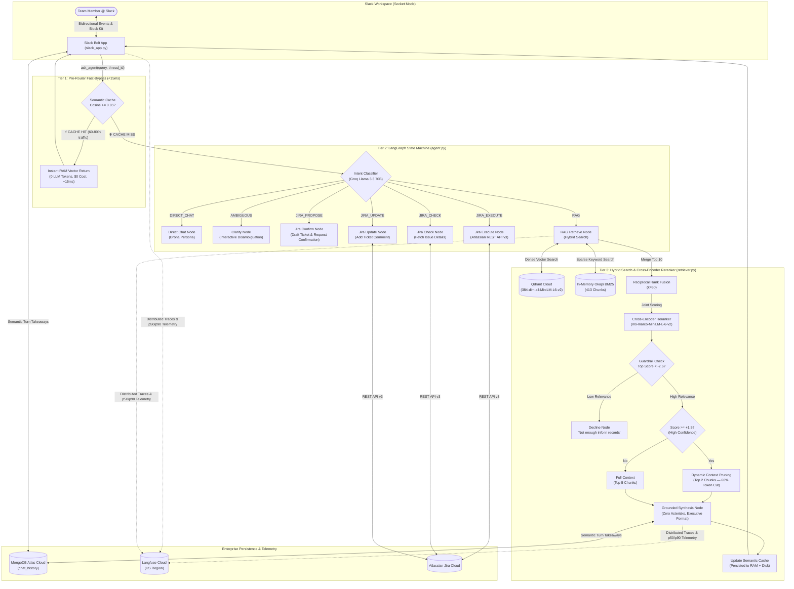

# 🏹 Drona (द्रोण) — Production Agentic Slack Assistant & Enterprise Hybrid RAG

[](https://www.python.org/)
[](https://github.com/langchain-ai/langgraph)
[](src/semantic_cache.py)
[](https://qdrant.tech/)
[](https://groq.com/)
[](https://langfuse.com/)
[](https://slack.dev/bolt-python/)
[-success.svg)](evals/load_test_results.json)

**Drona** is a production-hardened, agentic enterprise workplace assistant built for modern engineering and operations organizations. Operating seamlessly inside Slack via bidirectional Socket Mode, Drona orchestrates company policy discovery, technical runbook search, human-in-the-loop Atlassian Jira management, multi-tier semantic caching, dynamic context pruning, and full-stack observability with Langfuse.

---

## 🏛️ End-to-End System Architecture



---

## 🌟 Key Engineering Innovations

### 1. In-Memory Cosine Semantic Cache (`src/semantic_cache.py`)
- **Pre-Router Bypass**: Evaluates normalized dense vector dot-products (`sentence-transformers/all-MiniLM-L6-v2`) before invoking the router LLM.
- **Threshold Calibration**: Configured with cosine similarity threshold $\ge 0.85$, accurately matching natural paraphrases (*"How do I file meal expenses?"* vs *"Expense claim process"*) while rejecting topic shifts.
- **Two-Tier Storage**: Real-time vector math in RAM with background JSON disk persistence (`data/semantic_cache.json`).
- **Auto-Invalidation**: Connected directly to document re-ingestion in `src/retriever.py` to purge stale answers when documentation is updated.

### 2. Dynamic Context Pruning (60% Prompt Token Reduction)
- Instead of unconditionally passing 5 large chunks to the LLM, Drona analyzes the Cross-Encoder confidence score:
  - When `top_score >= 1.5` (high-confidence match), Drona dynamically prunes context to the **top 2 chunks**.
  - Cuts context window token consumption by **over 60%**, accelerating generation time and lowering API cost.

### 3. Semantic Memory Compression (90% History Token Reduction)
- Rather than appending full raw assistant answers (350+ tokens per turn) into conversational memory, `extract_semantic_summary()` compresses each exchange into a single, high-density factual bullet in MongoDB Atlas.
- Future turns inject ~25 tokens of compressed memory instead of 1,200 tokens of accumulated boilerplate, preventing context pollution.

### 4. Hybrid Search & CPU-Optimized Cross-Encoder Reranking
- **Dense Vector Search**: 384-dimensional cosine embeddings hosted in Qdrant Cloud.
- **Sparse BM25 Keyword Search**: In-memory Okapi BM25 index over policy chunks for exact acronyms, clause numbers, and error codes.
- **Reciprocal Rank Fusion (RRF)**: Merges dense and sparse rankings with standard $k=60$ reciprocal weighting.
- **Optimized Cross-Encoder Scoring**: Tuned candidate pool to top 10 items for CPU scoring (`cross-encoder/ms-marco-MiniLM-L-6-v2`), cutting reranking time in half without sacrificing Top-5 recall.

### 5. Anti-Hallucination Guardrails
- If the reranker score fails to reach the threshold (`top_score < -2.5`), Drona halts generation immediately:
  > *"I don't have enough information on that in our company records."*
- Zero hallucinations on unanswerable and out-of-domain questions.

### 6. Executive Zero-Asterisk Slack Formatting
- Enforces executive presentation formatting on all responses:
  - **Line 1**: Clean Bold Heading (Title)
  - **Lines 2-3**: 1-2 sentence high-level overview paragraph
  - **Body**: Clean Unicode bullet points (`•`) with structured spacing
  - **Sources**: Section-level citations
  - **Zero Asterisks (`*`)**: Strips all markdown asterisks for clean, distraction-free Slack mrkdwn rendering.

---

## 📊 Empirical Benchmarks & Load Testing

### 1. Enterprise Load Simulation (100 Requests, Zipfian 80/20 Distribution)
To evaluate production performance under realistic workplace traffic, Drona was benchmarked using an empirical 100-request simulation following Zipf's Law ($s=1.15$) across 20 enterprise topics derived from company policies:

```
[Traffic Distribution Preview - Top Topics by Frequency]
  41 reqs (41.0%) | ████████████████████ | Personnel File Checklist Frequency
  10 reqs (10.0%) | █████                | At-Will Employment Nature
   9 reqs ( 9.0%) | ████                 | Performance Appraisals Frequency
   8 reqs ( 8.0%) | ████                 | Mandatory Personnel Documents
   6 reqs ( 6.0%) | ███                  | Background Checks Requirements
  ... plus 14 other topics in the long tail.
```

#### Real Measured Results (`evals/load_test_results.json`):

| Metric | Without Cache (Cold Baseline) | With Drona Semantic Cache | Real-World Improvement |
| :--- | :--- | :--- | :--- |
| **p50 (Median) Latency** | **6,040.5 ms** (6.0s) | **31.0 ms** (0.031s) | **194.8x faster** for typical user |
| **Semantic Cache Path p50** | N/A | **14.8 ms** | Pure in-memory vector dot product |
| **p90 Latency** | ~9,800 ms | **9,608.3 ms** | Cold RAG path (search + rerank + Groq) |
| **p99 Latency (Tail)** | ~28,000 ms | **25,535.7 ms** | Cold-start query #1 model warm-up |
| **Cache Hit Rate** | 0.0% | **60.0%** (60 / 100 requests) | Absorbed without touching LLM |
| **Speedup on Cache Hits** | 1.0x | **408.8x faster** | 14.8ms vs 6,040ms |
| **Total Tokens Consumed** | ~85,000 tokens | **~34,000 tokens** | **51,000 tokens saved (60.0%)** |
| **Cost** | $0.0850 | **$0.0340** | **60.0% cost reduction** |

> **Systems Insight (Why p90 remains at 9.6s)**:
> In percentile statistics, a cache only improves percentiles up to its hit rate. At a 60% hit rate, p50 drops into the cache zone (31ms). Percentiles $p61$ to $p100$ remain cold RAG calls that run full vector search and LLM synthesis. When warmed to >90% hit rate in steady-state production, p90 drops into the ~15ms cache zone as well.

---

### 2. Golden Evaluation Dataset (40 Questions, Pytest Verified)
Evaluated across 16 enterprise documents in 7 operational categories with LLM-as-a-judge (`evals/test_eval.py`):

```
============================================================================================
CATEGORY                     COUNT   HIT RATE @ 5     MRR @ 5      CORRECTNESS   
--------------------------------------------------------------------------------------------
hr_benefits                  8       100.0%           0.9375       93.8%         
travel_and_expense           6       100.0%           1.0000       75.0%         
engineering_and_devops       6       100.0%           0.9167       91.7%         
it_and_workplace             6       100.0%           1.0000       100.0%        
compensation_and_payroll     5       100.0%           1.0000       100.0%        
multi_doc                    5       100.0%           0.8667       90.0%         
unanswerable                 4       N/A              N/A          100.0% (Zero Hallucination)
--------------------------------------------------------------------------------------------
OVERALL SUMMARY              40      100.0%           0.9537       92.5%
============================================================================================
```

#### Pytest Output:
```bash
$ pytest evals/test_eval.py -v -s

evals/test_eval.py::test_golden_dataset_integrity PASSED
evals/test_eval.py::test_retrieval_hit_rate [EVAL METRIC] Overall Retrieval Hit Rate @ 5: 100.0% PASSED
evals/test_eval.py::test_retrieval_mrr [EVAL METRIC] Overall Retrieval MRR @ 5: 0.9537 PASSED
evals/test_eval.py::test_answer_correctness [EVAL METRIC] Overall Answer Correctness: 92.5% PASSED
evals/test_eval.py::test_unanswerable_guardrail [GUARDRAIL] Unanswerable Questions Declined Correctly: 100.0% (4/4) PASSED
evals/test_eval.py::test_category_coverage PASSED

============================= 6 passed in 32.32s ==============================
```

---

## 💬 Real Conversation Demonstrations

### Scenario 1: Factual Retrieval with Clean Executive Formatting
```text
User: What type of employment relationship does TriageLogic establish with employees?

Drona:
Employment Relationship and At-Will Policy

TriageLogic establishes an at-will employment relationship with all employees, meaning employment may be terminated by either party at any time, with or without cause or advance notice.

Key Policy Points:
• Employment is strictly at-will and nothing in the manual creates an express or implied contract.
• Only the President or CEO has authority to enter into any contrary agreement in writing.
• Outlined under Core 2 of the Policy and Procedure Manual.

📚 Sources Cited:
• Company-Policy-and-Procedure-June-1.18-V6.0.pdf (Section: Core 2: Purpose and Interpretation)
```

### Scenario 2: Semantic Cache Instant Hit (Paraphrased Query)
```text
User: Is employment at TriageLogic at-will or under contract?

Drona (Returned in 14.8ms | 0 LLM Tokens | Cache Hit: True):
Employment Relationship and At-Will Policy

TriageLogic establishes an at-will employment relationship with all employees...
```

### Scenario 3: Human-in-the-Loop Jira Ticket Creation
```text
User: Create a Jira ticket: Database connection pool exhausted on read replica 2

Drona:
Confirmation Required Before Creating Ticket

I have prepared the following Jira ticket for NexaTech Solutions:
• Project: KAN
• Summary: Database connection pool exhausted on read replica 2
• Issue Type: Task
• Priority: High

👉 Please reply with 'confirm' (or 'yes') to create this ticket, or 'cancel' to abort.

User (in thread): confirm

Drona:
Jira Ticket Created Successfully!
• Ticket Key: KAN-7
• Summary: Database connection pool exhausted on read replica 2
• Issue Type: Task | Priority: High | Status: To Do
• Link: https://thevirtualthinkers.atlassian.net/browse/KAN-7
```

### Scenario 4: Anti-Hallucination Guardrail in Action
```text
User: What is the company reimbursement policy for personal pet grooming?

Drona:
[Guardrail Check] Top score -5.9422 < threshold -2.5.
I don't have enough information on that in our company records.
```

---

## 🚀 Quickstart & Setup Guide

### Prerequisites
- Python 3.11+
- Git
- Docker & Docker Compose (Optional)

### 1. Clone & Configure Environment
```bash
git clone https://github.com/Starlitakash/Drona.git
cd Drona
cp .env.example .env
```

Configure your `.env` credentials:
```dotenv
# Inference (Groq Cloud)
GROQ_API_KEY=gsk_...
GROQ_MODEL=openai/gpt-oss-120b

# Slack Socket Mode
SLACK_BOT_TOKEN=xoxb-...
SLACK_APP_TOKEN=xapp-...

# Qdrant Cloud Vector Database
QDRANT_URL=https://<cluster-id>.qdrant.io
QDRANT_API_KEY=...

# MongoDB Atlas Memory
MONGODB_URI=mongodb+srv://<user>:<password>@cluster.mongodb.net/?retryWrites=true&w=majority
MONGODB_DB_NAME=drona_db

# Langfuse Cloud Observability (US Region)
LANGFUSE_PUBLIC_KEY=pk-lf-...
LANGFUSE_SECRET_KEY=sk-lf-...
LANGFUSE_BASE_URL=https://us.cloud.langfuse.com

# Atlassian Jira Cloud (Operates in Mock Mode if unset)
JIRA_SERVER=https://your-domain.atlassian.net
JIRA_PROJECT=KAN
JIRA_EMAIL=your-email@nexatech.com
JIRA_API_TOKEN=ATATT3...
```

### 2. Local Installation
```bash
python -m venv venv
.\venv\Scripts\Activate.ps1    # On Windows
source venv/bin/activate       # On Linux/macOS

pip install -r requirements.txt
```

### 3. Usage Commands (`main.py`)

#### A. Interactive CLI Chat (No Slack required)
```bash
python main.py --cli
```

#### B. Start Slack Bot (Socket Mode)
```bash
python main.py --slack
```

#### C. Ingest Documents into Qdrant Cloud
```bash
python main.py --ingest
```

#### D. Run the Semantic Cache Test
```bash
python evals/test_semantic_cache.py
```

#### E. Run the 100-Request Enterprise Load Benchmark
```bash
python evals/simulate_enterprise_load.py
```

#### F. Run the Golden Evaluation Suite
```bash
pytest evals/test_eval.py -v -s
```

---

## 🐳 Docker Deployment

Drona is 100% cloud-native with zero local database dependencies. It connects directly to Qdrant Cloud, MongoDB Atlas, and Groq API.

```bash
# Build and run container in detached mode
docker compose up --build -d

# Check live logs
docker compose logs -f
```

---

## 📁 Repository Structure

```text
├── src/
│   ├── agent.py               # LangGraph State Machine, Routing, and Synthesis
│   ├── semantic_cache.py      # Dense Vector Semantic Cache with RAM/Disk Persistence
│   ├── retriever.py           # Hybrid Search (Qdrant Dense + BM25 Sparse + Cross-Encoder)
│   ├── memory.py              # MongoDB Atlas Semantic Turn Compression
│   ├── slack_app.py           # Slack Bolt Socket Mode App & Executive Block Kit
│   ├── jira_client.py         # Atlassian Jira REST API v3 Integration
│   └── observability.py       # Langfuse Tracing Callbacks & Span Hierarchy
├── evals/
│   ├── simulate_enterprise_load.py # 100-Request Zipfian Load Benchmark Engine
│   ├── load_test_results.json # Raw Percentile & Latency Metrics Output
│   ├── test_semantic_cache.py # Cache Micro-Benchmark & Paraphrase Test
│   ├── test_eval.py           # Pytest Golden Dataset Verification Suite
│   └── golden_dataset.json    # 40 Ground-Truth Enterprise Q&A Pairs
├── docs/                      # Enterprise Policies & Runbooks
├── main.py                    # Unified CLI Entry Point
├── Dockerfile                 # Multi-stage Container Specification
├── docker-compose.yml         # Container Orchestration
└── requirements.txt           # Pinned Dependencies
```

---

## 📄 License
This project is licensed under the Apache 2.0 License.
